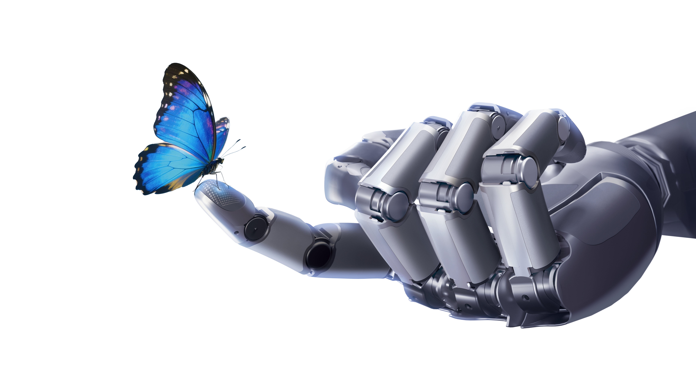
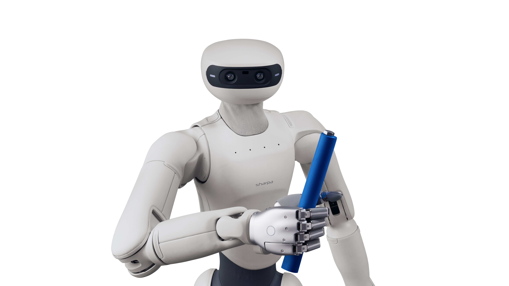
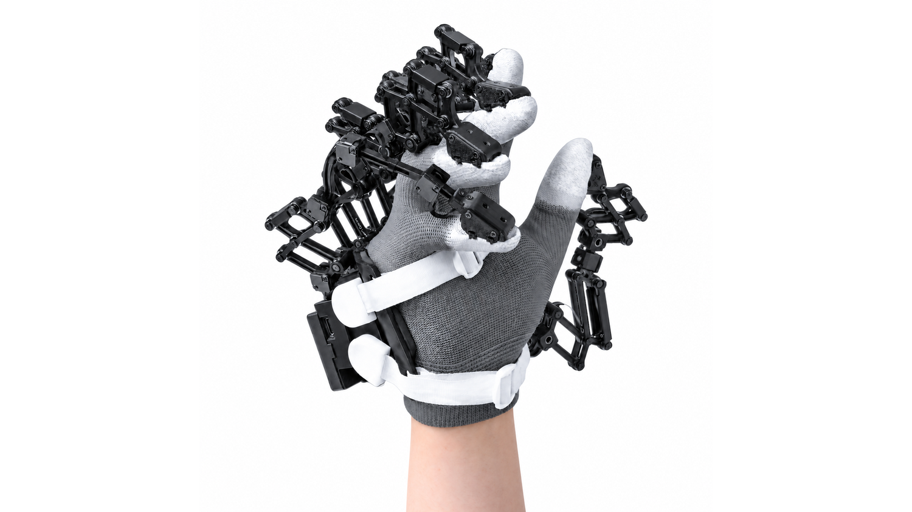
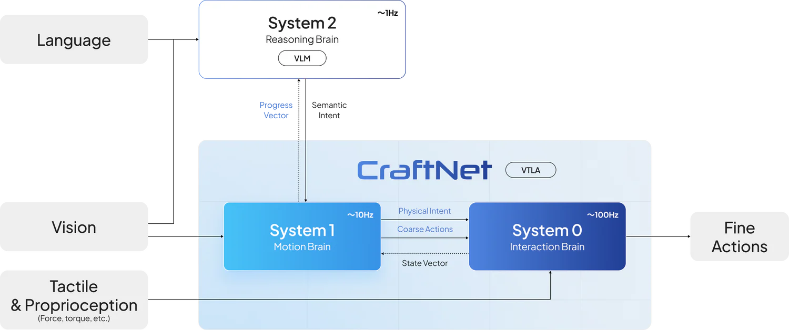

    <picture>
        <source media="(prefers-color-scheme: dark)" srcset="../images/logo-light.svg">
        <source media="(prefers-color-scheme: light)" srcset="../images/logo-dark.svg">
        
    </picture>

### Manufacture Time by Making Robots Useful

### 🚀 About Sharpa

---

Sharpa is an AI robotics company building ultra-high performance robots and core components to unlock the limitless possibilities of future general-purpose robots.

Sharpa builds robots not to replace people, but to help. When robots take on repetitive, strenuous tasks, people can step away and pursue more meaningful endeavors.
More time is deposited into everyone’s time bank. We give time back to humans.

### 🤖 Products & Technology

---

<table>
  <tr>
    <td width="50%" align="center">
      
    </td>
    <td width="50%" align="center" valign="middle" style="vertical-align: middle;">
      <motion.div class="wave-text">
        <h3>
          Wave
        </h3>
        
A revolutionary dexterous robotic hand designed to match the human hand in size, structure, and tactile sensitivity.

        

          <a href="https://www.sharpa.com/pages/w01">W01</a>
          |
          <a href="https://www.sharpa.com/pages/w02">W02</a>
        

      </motion.div>
    </td>
  </tr>
  <tr>
    <td width="50%" align="center">
      
    </td>
    <td align="center" valign="middle" style="padding-bottom: 32px">
      <h3>
        Droid
      </h3>
      
An integrated tactile-sensing humanoid robot with dexterous hands, 7-DoF arms, and whole-body E-skin for agile, precise manipulation in real-world tasks.

      

        <a href="https://www.sharpa.com/pages/d01">D01</a>
      

    </td>
  </tr>
  <tr>
    <td width="50%" align="center">
      
    </td>
    <td align="center" valign="middle" style="padding-bottom: 32px">
      <h3>
        Avatar
      </h3>
      
An Exoskeleton Data Glove with Haptic Feedback for Precise Teleoperation and Egocentric Data Capture.

      

        <a href="https://www.sharpa.com/pages/ae01">AE01</a>
      

    </td>
  </tr>
  <tr>
    <td width="50%" align="center">
      
    </td>
    <td align="center" valign="middle" style="padding-bottom: 32px">
      <h3>
        CraftNet
      </h3>
      
An end-to-end, hierarchical VTLA model for fine manipulation, enabling native, anthropomorphic last-millimeter interaction.

    </td>
  </tr>
</table>

### 📂 Downloads

---

<table>
  <tr>
    <td rowspan="4" width="120" align="center" valign="middle"><b>Device Software</b></td>
    <td>
      
    </td>
    <td>Sharpa Pilot is the official application for device configuration, monitoring, firmware updates, and routine operations.</td>
  </tr>
  <tr>
    <td>
      
    </td>
    <td>Sharpa Wave firmware is the embedded software on Sharpa Wave that runs low-level control, sensing, and host communication for use with Sharpa Pilot and Sharpa Wave SDK.</td>
  </tr>
  <tr>
    <td>
      
    </td>
    <td>Sharpa Avatar App is the official desktop application for configuring and monitoring the Sharpa AvatarExo Glove, visualizing its data, and using it to teleoperate Sharpa Wave.</td>
  </tr>
  <tr>
    <td>
      
    </td>
    <td>Embedded firmware for the Sharpa AE01 Glove, supporting sensor data acquisition, tactile feedback, wired USB and 2.4 GHz wireless communication, and device operation.</td>
  </tr>
  <tr>
    <td rowspan="4" width="120" align="center" valign="middle"><b>Developer SDKs</b></td>
    <td>
      
    </td>
    <td>Sharpa Wave SDK provides libraries and APIs for integrating Sharpa Wave into custom applications and robotics software stacks.</td>
  </tr>
  <tr>
    <td>
      
    </td>
    <td>Hand Tracking & Retargeting for Manus MetaGloves Pro.</td>
  </tr>
  <tr>
    <td>
      
    </td>
    <td>Hand tracking and retargeting for Sharpa Wave using webcams or Meta Quest.</td>
  </tr>
  <tr>
    <td>
      
    </td>
    <td>Sharpa Avatar SDK provides libraries and APIs for integrating Sharpa AvatarExo Glove into custom applications and robotics software stacks.</td>
  </tr>
  <tr>
    <td rowspan="2" width="120" align="center" valign="middle"><b>AI Models</b></td>
    <td>
      
    </td>
    <td>[CoRL'2026] WM-Craftnet: World Synesthesia Model for Generalizable and Robust Dexterous In-Hand Manipulation.</td>
  </tr>
  <tr>
    <td>
      
    </td>
    <td>DeformEncoder converts preprocessed single-channel deformation images into compact tactile features.</td>
  </tr>
  <tr>
    <td rowspan="5" width="120" align="center" valign="middle"><b>Simulation Resources</b></td>
    <td>
      
    </td>
    <td>Mechanical CAD files of Sharpa Wave adapter and simplified models.</td>
  </tr>
  <tr>
    <td>
      
    </td>
    <td>Assets for Sharpa hardware.</td>
  </tr>
  <tr>
    <td width="280">
      
    </td>
    <td>Sharpa tactile sensor static assets.</td>
  </tr>
  <tr>
    <td>
      
    </td>
    <td>Sharpa tacmap tactile sensor in Isaac Lab.</td>
  </tr>
  <tr>
    <td>
      
    </td>
    <td>Sharpa reinforcement learning example in Isaac Lab.</td>
  </tr>
  <tr>
    <td width="120" align="center" valign="middle"><b>Community</b></td>
    <td>
      
    </td>
    <td>Official community and discussion forum for sharpa. Ask questions, share ideas, and connect with other users.</td>
  </tr>
</table>

### 📧 Contact Us

---

Have questions or want to collaborate? Get in touch with the right team at Sharpa:

- **Sales:** [sales@sharpa.com](mailto:sales@sharpa.com)  
- **PR / Media:** [pr@sharpa.com](mailto:pr@sharpa.com)  
- **Technical Support:** [support@sharpa.com](mailto:support@sharpa.com)
